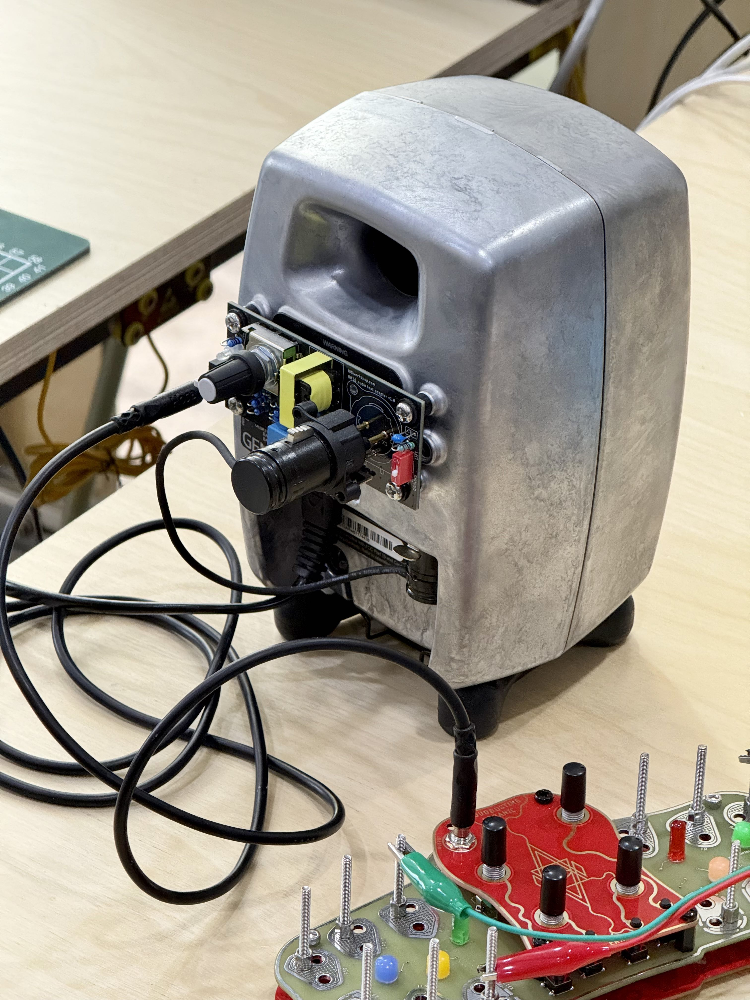
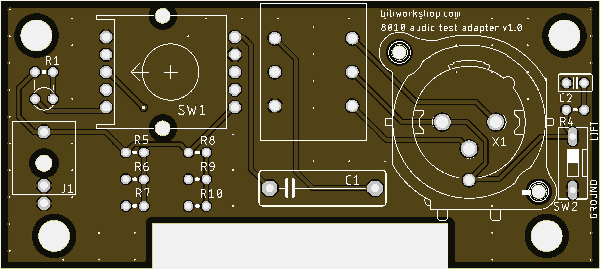

# lab_8010diadapter
I designed this DI box, which mounts directly onto the back of a Genelec 8010, for use during synthesizer development and workshops. It supports both line-level and Eurorack-level signals and includes a ground-lift function, helping to prevent damage to your speakers while you’re testing synthesizers. I have now made it open-source.

**8010 DI adapter**

## Main features:
* The rotary switch offers four settings: Mute, -40dB (for Eurorack-level signals), -20dB, and Pass-through.
* When the rotary switch is set to "Mute," the indicator light can still show the presence of a signal.
* The "Ground Lift" switch allows for the disconnection of the ground line, which can help eliminate noise in certain scenarios.
* A 10K:600 transformer is used for isolation, providing protection for your speakers.

## Schematics
**PDF中的元件数值可能不正确，请以BOM表格为准**

## PCB

## Bill of materials
| Designator                   | Qty | Value              | Footprint     | Description                    | Ref. Mouser                          | Ref. LCSC | References                            |
|------------------------------|-----|--------------------|---------------|--------------------------------|--------------------------------------|-----------|---------------------------------------|
| **PTH parts**                |     |                    |               |                                |                                      |           |                                       |
| C2                           | 1   | 22uF               | D6.3xL7mm     | Electrolytic                   | 647-UKL1V220KEDANA                   | C433313   | Nichicon USV1V220MFD                  |
| C1                           | 1   | 120uF              | D8xL7mm       | Electrolytic                   | 667-50SEK120M                        | C3010233  | PANASONIC 50SEK120M                   |
| KK1, KK3, KK4                | 3   | Heat sink          |               | Heat sink                      | 532-529702B25G                       | C286227   | Heat sink                             |
| J1                           | 1   | DC Power Connector |               | 2.1 mm, 5.5 mm                 | 710-694106301002                     | C136744   | Wurth Elektronik 694106301002         |
| J2, J6                       | 2   | M3 screw terminal  |               | terminal (Optional)            | 534-7770                             | C481448   | Keystone 7770                         |

## License
**The lab_8010diadapter project is made available under a CC-BY-NC-SA-3.0 license.**

If you want to make a few cases for your own use, go ahead and make them. If you're a synth studio and want to use them for product testing/demonstration etc, that's also welcome as long as it doesn't involve selling these directly. **Please do not make and sell these in bulk.**

## Links
Official website:  https://bitiworkshop.com/
Purchase here: https://store.bitiworkshop.com/

